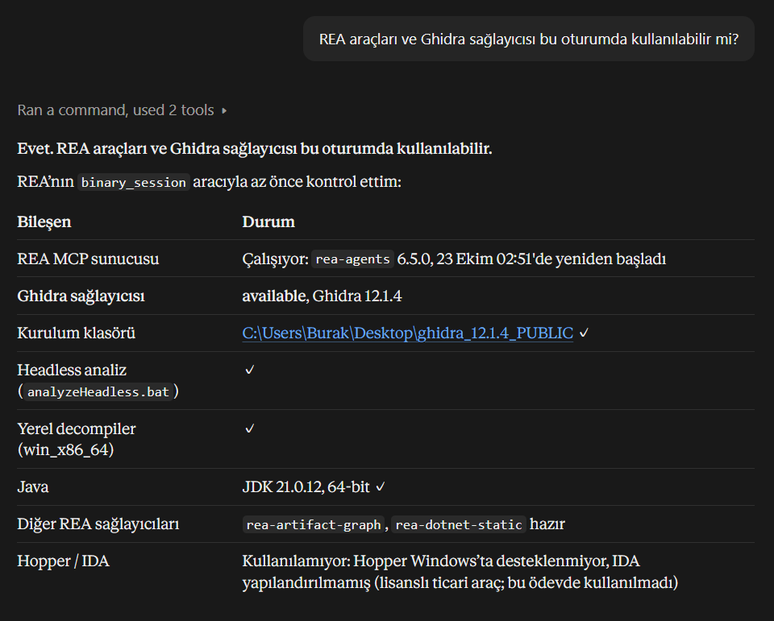

# Bağımsız t güç hesabı — 0.4.3

- **Ad Soyad:** İsmail Burak Yılmaz
- **Grup / takım numarası:** 20
- **Çalışma biçimi:** Bireysel; proje tek kişi tarafından yürütülmüştür.

## Yapılan bonus katmanları ve kanıtları

| Katman / ölçüm | Yapılan ve kanıtın kapsamı | Kanıt |
|---|---|---|
| MCP sunucusu | Tek power_analysis aracı; kurulu CLI ve ayrı MCP stdio sürecinde 25/25 açık vektör eşdeğerliği | [25 gerçek CLI–MCP karşılaştırması](reports/spec_1_1_0/release_0_4_2_20261023/public25.json) |
| Türkçe araç ajanı | Tarihî 0.3.0, SPEC 1.0.1'in görülmüş 10+4 sorusu: sistem 14/14, ham model 13/14; 1 guard müdahalesi. Yeni 0.4.3 model ölçümü değildir | [Gerçek değerlendirme özeti](reports/agent_0_3_0_measured_summary.json), [kapsam raporu](reports/AGENT_0_3_0_REPORT.md), [çağrı günlüğü](logs/agent_calls.jsonl) |
| GUI–MCP token/süre/doğruluk karşılaştırması | Aynı 10 tarihî soru; bildirilmiş GUI 64753 ve MCP 13356 token. Son N 10/10; GUI ilk iş akışı 7/10 ve ilk model planı 8/10; GUI insan işletimli ve yardımlı, iki ret için usage bilinmiyor | [Ölçüm raporu](reports/GUI_MCP_TEMIZ_RAPOR.md), [makine özeti](reports/GUI_MCP_TEMIZ_OZET.json) |

İsteğe bağlı **Jev/Sistem-1 uygulanmadı**. Bunlar yapılan katman ve deneylerdir; bonusun kazanıldığı veya gizli AP %90 kapısının geçildiği iddia edilmez. Tarihî logların dönüştürülmesi yeni CONTRACT ile yeni model ölçümü sayılmaz.

Bağımsız eğitim çalışmasıdır; G*Power ürünü veya yazarlarıyla bağlantılı değildir.
Güncel davranış kaynağı **SPEC 1.1.0** (2026-10-22), SHA-256
`016233430d0f4337c8d1de36a51747654fea31da2448a0798e17c47217cccdbe`.
Resmî ders arayüzü **CONTRACT 1.0.0** (2026-10-21), SHA-256
`4cbcc105a31f4b202f3e9a8d2cc0e9d4a8b94933997e47e3e00965f1f67f999f`;
tam metni SPEC içinde gömülüdür ve paketlerde `docs/CONTRACT.md` olarak bulunur.
SPEC'in uygulama öncesini anlatan durum cümleleri test sonucu değildir;
aşağıdaki durum mevcut kaynak ve tamamlanmış koşu kanıtlarına dayanır.

Yalnız eşit varyanslı iki bağımsız grubun Student t testi (`t2-indep`), Cohen d,
`a-priori` ve `post-hoc`, tek/iki yön desteklenir. Welch, eşleştirilmiş test,
diğer dört aile, `compromise`, `criterion` ve `sensitivity` hesaplanmaz.
CLI ve stdio MCP aynı adaptör ve motoru çağırır. Türkçe araç ajanı korunur;
isteğe bağlı Jev/Sistem-1 sınıflandırıcısı uygulanmadı. Bonus puanı, gizli
test başarısı veya tam sayısal uyum iddia edilmez.

**0.4.3 için açık kullanıcı onayı:** engine.py'de yalnız dağılım importu küçük
yerel skaler SciPy sarmalayıcısına geçirildi. SPEC'teki tarihî engine hash'i
korundu; güncel engine kimliği ve provenance yeni raporda ayrıdır. N araması,
tahsis, yuvarlama, contract.py, SPEC, Windows lock ve sayısal beklentiler aynı.
Üretim hesabı artık scipy.stats yüklemez; yerel testler bunu referans olarak
yükleyebilir. [Kaynak/lisans ve özel API sınırı](docs/SCIPY_SOURCES.md).

## Gerçek test durumu

Tam koşu **2026-10-23 (Türkiye saati)**, Python 3.14.8;
gerçek pytest çıkış kodu **1**.
[Üç Python gerçek test matrisi](reports/spec_1_1_0/release_0_4_3_20261023/python_matrix.json)
ve yanındaki pytest_3_12/3_13/3_14 XML/stdout/stderr dosyaları son kaynakların
kanıtlarıdır. Yerel alt süreç testleri sandbox dışında tamamlandı. Önceki
0.4.2 paket ve kanıtları değiştirilmedi.

| Ölçüt | Sonuç |
|---|---:|
| Tam koşu | **2280 test; 2178 geçti, 102 başarısız, 0 hata, 0 atlanan** |
| Son kaynaklarla Windows Python 3.12.15 / 3.13.16 / 3.14.8 | Her birinde 2178/2280; aynı 102 kimlik |
| Önceki 0.4.2 koşusu | 2280 test; 2178 geçti, aynı 102 başarısız |
| Önceki 0.4.1 koşusu | 2275 test; 2173 geçti, aynı 102 başarısız |
| Önceki 0.4.0 koşusu | 2269 test; 2167 geçti, 102 başarısız |
| Eklenen alt süreç testleri | 6/6; lazy import ve injection yüzeyi |
| Yeni hazırlık kontrolleri | 5/5; tek çağrı, pycache kanıtı ve hatalı sonucu reddetme |
| Katı ham oracle başarısızlığı | **13** |
| Resmî sayısal karşılaştırma başarısızlığı | **11** |
| statsmodels karşılaştırması başarısızlığı | **78** |
| Tarihî özgün sözleşme denetimi | 139/139; SPEC §6.5 kaydı, bu kapanışta tekrar edilmedi |
| Gerçek CLI–MCP açık vektör eşdeğerliği | 25/25; kurulu exe ve ayrı kurulu MCP stdio süreciyle yeniden ölçüldü |
| Önceden bildirilen ek 18/18 davranış denetimi | Ayrı makbuzu izinli güncel raporlarda bulunamadı; yeni koşu gibi sunulmaz |
| Gizli test / gizli AP %90 kapısı | Bilinmiyor |

13 katı başarısızlık: **11 büyük N vektörü** (GP-AP-019, GP-AP-039–044,
GP-AP-047–050), **GP-AP-028** ve **GP-AP-025**.
GP-AP-028'in negatif d girdisi resmî d>0 alanında reddedilir; ham motorun
eski oracle karşılaştırması korunur ve başarısız kalır. GP-AP-025 tek yönlü
alpha=0.5 kritik değer gürültüsünde katı ölçütü karşılamaz.
Resmî ölçütteki 11 başarısızlık **aynı 11 büyük N vektörünün farklı ölçütlü
testleridir**; 13+11 test başarısızlığı 24 bağımsız vektör değildir.
78 statsmodels başarısızlığı belgelenmiş kütüphane sınırlarıyla ilişkilidir;
geçen test olarak etiketlenmez. Beklentiler, toleranslar ve test paydası
değiştirilmedi; skip/xfail/istisna eklenmedi.
102 başarısız testin kimlikleri önceki koşuyla aynıdır. Metadata testindeki
tek sürüm beklentisi 0.4.2→0.4.3 ve açıkça onaylanan güncel engine hash
beklentisi güncellendi; tarihî hash silinmedi. Sayısal testler değişmedi.
[142 gerçek kurulu CLI karşılaştırması](reports/spec_1_1_0/release_0_4_3_20261023/cli_142_comparison.json)
stdout/stderr/exit baytlarında 142/142 birebir eşitlik gösterir. Ham motor
nesneleri ve float.hex değerleri de aynıdır. Bu, G*Power'a yeni uyum kazanımı değildir.

## Sayısal ölçütler ve ayrı paydalar

Sıkı ölçüt, G*Power'ın gösterdiği basamaktan türetilen değişmemiş toleransları
kullanır; sıfır/tamsayı kuralları ayrıdır. CONTRACT ölçütünde n1/n2/N/df tam
eşit; diğer alanlarda mutlak fark ≤1e-6 **veya** fark ≤1e-6·abs(referans)
aranır. Göreli paydanın seçimi proje kararıdır. NaN/Infinity eşleşmez.
`critical_t`, ham motorun `critical` alanının aynı tam hassasiyetli sayısıdır.

| Küme | Sıkı tüm alan | Sıkı AP tahsis | CONTRACT tüm alan | CONTRACT AP tahsis |
|---|---:|---:|---:|---:|
| Eski 87 | 74/87 | 39/51 | 61/72 | 36/47 |
| Tur 6 | 20/20 | 20/20 | 19/19 | 19/19 |
| Tur 7 | 27/27 | 21/21 | 21/21 | 17/17 |
| Tur 8 | 8/8 | 5/5 | 8/8 | 5/5 |
| Yeni 55 (Tur 6+7+8) | 55/55 | 46/46 | 48/48 | 41/41 |
| Bütün 142 | 129/142 | 85/97 | 109/120 | 77/88 |

Kaynak: [güncel diferansiyel raporu](reports/spec_1_1_0/DIFFERENTIAL_REPORT.md)
ve yanındaki JSON/CSV. Eski 87 (51 AP+36 PH) ile yeni 55 (46 AP+9 PH)
birleşimi 142 ham GUI hesabıdır. Bunların 22'si resmî giriş alanı dışında;
resmî sayısal payda **120 = 88 AP+32 PH** olur. Bu retler ham oracle
başarısızlığını silmez. Resmî ret denetimleri **47/47 = 22 alan dışı GUI
hesabı+25 girdi gözlemi**. Ayrı **25 açık CLI/MCP vektörü**, iki sayısal K1
ve 23 ortak kapsam reddidir; sayısal GUI paydasını artırmaz.
Yerel AP oranları gizli %90 kapısının geçildiğini kanıtlamaz.

### Bilinen farklar: ölçülen N bölgeleri

Aşağıdaki bölme **CONTRACT alanındaki 88 a priori** girdiyi, G*Power'ın referans toplam N değerine göre ayırır. Ölçülen küme için betimseldir; klinik uygunluk veya gizli test dağılımı iddiası değildir.

| Bölge / alt küme | AP n1/n2/N tam eşleşmesi | Açıklama |
|---|---:|---|
| N ≤ 3·10⁷ | **75/75** | Bu ölçülmüş bölgedeki tüm tahsisler eşleşti |
| N > 3·10⁷ | **2/13** | GP-AP-045 ve GP-AP-046 eşleşti; 11 büyük N farkı kaldı |
| Bilinen 11 büyük N uyuşmazlığı (üst satırın alt kümesi) | **0/11** | GP-AP-019, GP-AP-039–044, GP-AP-047–050 |
| Toplam (alt küme satırı tekrar eklenmez) | **77/88** | Gizli AP %90 kapısı bilinmiyor |

Eşik veya payda GP-AP-045/046 sonuçlarını dışlamak için seçilmedi. Büyük N farklarının sayısal dağılım/arama davranışına ilişkin bulgu ve sınırlar [SPEC Bölüm 13/15](SPEC.md) içindedir; N aramasının birebir taklit edildiği veya tek nedenin kesin kanıtlandığı iddia edilmez. Ham farklar [diferansiyel alan kaydında](reports/spec_1_1_0/differential_fields.csv), önce/sonra motor ve CLI nesneleri [142 vektör makbuzunda](reports/spec_1_1_0/release_0_4_2_20261023/vectors_after.json) korunur.

## Kurulum ve kısa kullanım

Repoyu klonlayıp veya kaynak ZIP'i açıp kökünde Windows PowerShell ile:

```powershell
& .\install.ps1
gpower-clone --version
```

Betik proje içine uv 0.13.4 ve yönetilen CPython 3.14.8 kurar; kilitli
bağımlılıkları ve uygulamayı `.run` içine **--compile-bytecode** ile yükler.
**Kurulum bir kez gerçek hesapla SciPy hazırlığı yapar; ilk soğuk çağrı ortama
bağlı olarak 2 s'yi aşabilir; ölçülen değerler aşağıdadır.** Hazırlık, kurulu
gpower-clone exe/entrypoint'i üzerinden bu README'nin 105/105/210 AP örneğidir;
yalnız import veya --version değildir. Süresi kurulum maliyeti olarak kaydedilir.
Yanlış/eksik/sonlu olmayan hesap çıktısı veya başarısız exit kurulum başarısı
sayılmaz. Yeni boş venv'de bu ilk sayısal çağrıdır; reused ortamda yalnız bu
kurulum akışının ilk hesabıdır, ilk-ever/soğuk çağrı diye etiketlenmez.
İnternet ve dizine yazma izni gerekir. Destek metadata'sı **>=3.12,<3.15**;
bağımlılık ve Python aralığı bu kapanışta değiştirilmedi. Son 0.4.3 kaynakları
Windows Python 3.12.15, 3.13.16 ve 3.14.8'de tam 2280 testle doğrulandı.
SPEC'teki eski 2169 testlik sonuçlar ayrı tarihî kayıtlardır. Windows dışı
kurulum doğrulanmadı.
Üretim bağımlılıkları SciPy 1.16.3, MCP 2.3.0 ve httpx2 2.14.0;
tam kilit `requirements.lock.txt` içindedir. Motor statsmodels veya hazır N
çözücüsü kullanmaz. Yeni wheel'in temiz venv kurulum makbuzu kapanış raporundadır.

```powershell
.\.run\.venv\Scripts\gpower-clone.exe --version
.\.run\.venv\Scripts\gpower-clone.exe --test t2-indep --mode a-priori --tails 2 --d 0.5 --alpha 0.05 --power 0.95 --ratio 1
.\.run\.venv\Scripts\gpower-clone.exe --test t2-indep --mode post-hoc --tails 2 --d 0.5 --alpha 0.05 --n1 105 --n2 105
```

AP sonucu n1=105, n2=105, n_total=210; PH gücü yaklaşık
0.9501287033889153. Sonuçlar erken yuvarlanmaz.
Demo video: [YouTube — CLI demo (liste dışı, 63,94 saniye)](https://youtu.be/-rFo8gH4fU0) · [MP4 dosyası](docs/demo.mp4)
REA–Ghidra kullanılabilirlik kontrolü (23 Ekim 2026):



İlk oturumda (18 Ekim) uygulamaya kayıtlı REA sunucusunda GHIDRA_INSTALL_DIR tanımlı değildi; Ghidra aynı REA sürümüyle süreç ortamında çalıştırıldı (ENVIRONMENT.md). 23 Ekim’de kayda eklendi; görüntü bu ayardan sonra alındı.

## PATH, platform ve çevrimdışı kurulum

Yukarıdaki `& .\install.ps1`, betiği **mevcut PowerShell sürecinde** çalıştırır.
Varsayılan kurulum, açık kullanıcı kararıyla yalnız **HKCU kullanıcı PATH**'ine
kararlı `.run\.venv\Scripts` yolunu kaydeder ve betiğin çalıştığı süreç PATH'ini
günceller. HKLM/sistem PATH ve shell profili değiştirilmez. Aynı yol harf
büyüklüğü/son ayırıcı farkıyla tekrar eklenmez; yol ekrana açıkça yazılır.
`-NoPath` kaydı/bildirimi atlar. Ayrı `powershell.exe -File ...` üst kabuğun
PATH'ini değiştiremez; aynı kabukta `&` kullanın veya PATH'i Machine+User
değerlerinden açıkça yenileyin.

WM_SETTINGCHANGE/Environment bildirimi 2 sn sınırıyla gönderilir. Açık
Windows Terminal/Codex/PowerShell eski ortamı tutabilir. Gerçek yeni
PowerShell ve CMD testleri registry'den yeniden kurulmuş Machine+User PATH
ile, repo dışındaki boş dizinden **çıplak** komutları çalıştırdı. Bu bir
Explorer/Start menüsü GUI doğrulaması değildir.

Yalnız bu kurulumun eklediği yolu geri alma komutu; başka User PATH girdilerini
ve HKLM'yi değiştirmez. Özel hedefte `$addedPath` makbuzdaki yolu göstermelidir:

```powershell
$addedPath = Join-Path $PWD '.run\.venv\Scripts'
function Normalize-GPowerPath([string]$p) {
    if (-not $p.Trim()) { return '' }
    [IO.Path]::GetFullPath([Environment]::ExpandEnvironmentVariables($p.Trim().Trim('"'))).TrimEnd([char[]]'\/').ToUpperInvariant()
}
$key = [Microsoft.Win32.Registry]::CurrentUser.OpenSubKey('Environment', $true)
try {
    $value = [string]$key.GetValue('Path', '', [Microsoft.Win32.RegistryValueOptions]::DoNotExpandEnvironmentNames)
    $kind = $key.GetValueKind('Path')
    $remaining = @($value -split ';' | Where-Object { (Normalize-GPowerPath $_) -ne (Normalize-GPowerPath $addedPath) })
    $key.SetValue('Path', ($remaining -join ';'), $kind)
    $env:PATH = (@($env:PATH -split ';' | Where-Object { (Normalize-GPowerPath $_) -ne (Normalize-GPowerPath $addedPath) }) -join ';')
} finally { $key.Dispose() }
```

Proje kökü yedekleri PowerShell'de `.\gpower-clone.cmd --version`, CMD'de
`gpower-clone.cmd --version` şeklindedir. PowerShell mevcut dizindeki `.cmd`yi
çıplak adla kendiliğinden bulmaz. Özel hedef için `GPOWER_HOME` kurulum kökünü
gösterir. POSIX yedeği `./gpower-clone`; kurulum `sh ./install.sh` veya çalıştırma
izniyle `./install.sh`. Betik `~/.local/bin/gpower-clone` kullanıcı bağlantısı
koyar; bu dizin PATH'te değilse açıkça bildirir. `--no-path` bağlantıyı atlar;
shell profiline yazılmaz.

Windows kilidi değiştirilmedi. Windows dışı platform kilidinden yalnız
`pywin32==312` çıkarılır; diğer pinler aynıdır. Bu makinede WSL yüklü değil,
Docker bulunamadı: **Linux/macOS gerçek kurulum ve çalışma denenmedi**.
Git Bash `-n` kontrolü geçti; bu Linux kurulumu kanıtı değildir.

Çevrimdışı yol; uygun Python/uv **önceden mevcut** olmalı, bütün uyumlu
bağımlılıkları içeren wheelhouse veya dolu uv önbelleği gereklidir:

```powershell
& .\install.ps1 -Offline -UvPath C:\tools\uv.exe -PythonExecutable C:\Python314\python.exe -WheelPath C:\kit\independent_t_power-0.4.3-py3-none-any.whl -Wheelhouse C:\kit\wheelhouse
```

```sh
sh ./install.sh --offline --uv /path/to/uv --python /path/to/python3 --wheel /kit/independent_t_power-0.4.3-py3-none-any.whl --wheelhouse /kit/wheelhouse
```

Yerel uv önbelleği için Windows `-CacheDirectory`, POSIX `--cache-dir` kullanılır.
Her iki installer yolu bytecode derler ve aynı açık gerçek-hesap hazırlığını
çalıştırır; `scripts/prepare_runtime.py` kaynak ZIP/sdist ile gelir. Yalnız
uygulama wheel'i tam çevrimdışı kit değildir. **Standart pip/uv ile yalnız
wheel kurmak otomatik hesap çalıştırmaz; wheel'de post-install hook yoktur.**
Doğrudan wheel yolunu seçerseniz kurulumdan sonra açıkça bir kez gerçek örneği
çalıştırın ve ilk çağrının kurulum hazırlığı maliyetini ayrıca ölçün:

```powershell
gpower-clone --test t2-indep --mode a-priori --tails 2 --d 0.5 --alpha 0.05 --power 0.95 --ratio 1
```

## Başlatma süresi ve kalan risk

### 0.4.3 son kaynak ve temiz kurulum

`nct.cdf` için scipy.special.nctdtr, `t.ppf` için stdtrit kullanılır. SF,
NumPy over='ignore' bağlamında `_nct_sf` sonucunu [0,1]'e clip eder; 1-CDF ile
değiştirilmez. NaN/±infinity, df/nc ve q uçları her üç Python'da aynı
SciPy 1.16.3 stats ile **3048/3048 tam skaler karşılaştırmada** eşleşti.
Bu sarmalayıcı engine'in float64 skaler loc=0/scale=1 kullanımını kapsar;
genel array/loc/scale API'si değildir.

**Özel API riski:** `_nct_sf` SciPy'nin private sembolüdür. Yalnız sabit
scipy==1.16.3 desteklenir; başka sürüm modül guard'ıyla reddedilir. SciPy
güncellemesi kaynak incelemesi ve yeniden sınır/142/tam regresyon gerektirir.
SciPy BSD-3-Clause bildirimi wheel ve kaynak paketlerinde korunur. Bu değişiklik
yeni sayısal N yöntemi veya daha iyi resmî N uyumu sağlamaz.

Yeni boş NoPath venv'de gerçek kurulu hazırlık hesabı **7.753574 sn**, doğru
105/105/210, exit=0, stderr boş verdi. Sonraki 20 ayrı süreçte ilk/ikinci/medyan/max
**0.509311 / 0.519213 / 0.508347 / 0.537871 sn**; >2 s yok.
Hazırlık dahil ilk20 ve toplam21 ayrı saklanır: ilk ve max **7.753574 sn**,
bir >2 s aşımı. İlk çağrı paydadan kaybolmadı.
[Ham seri](reports/spec_1_1_0/release_0_4_3_20261023/timing_21.json).

Bu yeni kurulumun ilk ölçümüdür; OS disk/DLL cache sıcaklığı garanti edilmez.
Bu son kod için reboot ölçümü yapılmadı, yeni restart istenmedi. Kullanıcının
ayrı izole adayla reboot sonrası bildirdiği **1.7091611 sn**, boot 22:51:09.500+03,
start 22:52:02.539+03, hazırlıksız tek çağrı; aday hash'i
`f64f269a6b9cab31faee27884d47f7a05a542a99caeb70283d9d65d31560995d`.
Bu farklı adayın tek ortam ölçümüdür; bu kodun soğuk ölçümü veya evrensel 2 s
garantisi değildir. Önceki 5.915 sn bildirimi ve diğer aşım kayıtları korunur.
Hiçbir PATH/registry/Defender/güvenlik ayarı bu 0.4.3 doğrulamasında değiştirilmedi.

### Korunan 0.4.2 ölçümleri

0.4.2 ana zaman serisi yeni boş NoPath venv'dendir. Bytecode derlemesi bittikten
sonra, hazırlıktan önce **SciPy altında 99 __pycache__ dizini / 961 .pyc**
görüldü. Probe SciPy/NumPy import etmedi; örnek magic/cache_tag/mtime/size
başlıkları kayıtlıdır. Hazırlık gerçek exe'de doğru 105/105/210 sonucu verdi;
stdout/stderr/exit ve süre [hazırlık makbuzunda](reports/spec_1_1_0/release_0_4_2_20261023/preparation.json).

| Ayrı paydalar | İlk sn | İkinci sn | Max sn | >2 sn |
|---|---:|---:|---:|---:|
| Hazırlık dahil ilk 20 hesap (hazırlık + sonraki 19) | 17.498316 | 0.905857 | 17.498316 | 1 |
| Hazırlık sonrası 20 hesap (hazırlık hariç) | 0.905857 | 0.884184 | 0.927874 | 0 |
| Hazırlık dahil toplam 21 hesap | 17.498316 | 0.905857 | 17.498316 | 1 |

İlk aşım paydadan çıkarılmadı. Hazırlıktan sonra 20 çağrı burada ≤2 s olsa da
her ortam için garanti verilmez; cache/DLL sıcaklığı garanti edilmez. OS disk
önbelleğinin soğuk olduğu kanıtlanmadı. [21 ham çağrı ve üç özet](reports/spec_1_1_0/release_0_4_2_20261023/timing_21.json).

Kayıtlı çıplak komutla yeni PowerShell/CMD ölçümü **ayrı, önceden kullanılmış
kararlı .run** ortamındandır: --version 0.224539/0.143919 sn, yeni kabuğun ilk
AP çağrısı 1.012369/0.867807 sn (PS/CMD). Registry Machine+User PATH'inden kurulan
yeni ortam kullanıldı; eski Terminal'in ortamını güncel saymadık. Bu değerler
ana boş-venv serisinin ilk çağrıları değildir. Aynı test venv'inin yeni kabuk
ek ölçümleri de ayrı `same_venv_new_shells.json` kaydındadır; o ölçüm tam exe
yolu kullanır ve kayıtlı çıplak komut kanıtı sayılmaz.

**0.4.2 yeniden başlatma sonrası ilk çağrı 5,92 s (2 s üstü); sonraki hazırlıklı seri yaklaşık 0,9 s. Soğuk başlangıçta 2 s koşulu her ortamda sağlanmıyor.**

[Tek çağrı makbuzu](reports/spec_1_1_0/release_0_4_2_20261023/gpower-first-call-20261023_031619_0562281.json): 5.9152954 s, exit 0, 105/105/210; SHA-256 `bbf53b8b25281b8bf0bbdc96c5f5f8a7401ed6d87523433cfc3f41bb60945ae2`. Kullanıcı bilgisayarın 23 Ekim 02:57’de açıldığını, 03:16 ölçümüne kadar başka gpower-clone hesabı yapılmadığını bildirdi. Yaklaşık 0,9 s değeri önceki hazırlık sonrası seriye aittir; bu tek makbuzun ardından yeni 20 çağrı serisi yapılmış gibi sunulmaz. Ayrı adayın 22:52 ölçümü [kendi makbuzuyla](reports/performance_candidate/candidate-first-call-20261023_225202_5347368.json) korunur. İki kayıt farklı kurulum ve açılışlardandır.

Kullanıcı kontrollü ayrı bir ölçüm gerektiğinde kullanılabilecek tek çağrı betiği:

```powershell
powershell -NoProfile -ExecutionPolicy Bypass -File .\scripts\measure_once.ps1
```

Betik hazırlık yapmaz; tek hesap çalıştırır ve benzersiz tarihli JSON'a süre,
çıktı ve exit kaydeder. Defender/güvenlik ayarları değiştirilmedi, istisna eklenmedi.

### Korunan 0.4.1 ölçümleri

`--version` ve geçersiz girdi SciPy/NumPy/motor yüklemeden döner; fresh interpreter
import engelleyicisiyle doğrulandı. Hesap yolundaki aynı adlı lazy wrapper,
`interface.calculate` monkeypatch/injection yüzeyini korur. Motor değişmedi.

| Gerçek dizi; ilk çağrı dahil 20 | İlk (sn) | Medyan (sn) | En büyük (sn) | >2 sn |
|---|---:|---:|---:|---:|
| Örtüşen ön ölçüm | 16.56705 | 1.2657 | 16.56705 | 1 |
| Ağır işler sonrası yeni kurulum, yazılabilir | 15.57067 | 1.23374 | 15.57067 | 1 |
| ACL ile yazma reddi doğrulanmış, önceden kullanılmış kurulum | 1.11141 | 0.90701 | 1.11141 | 0 |

**0.4.1'de bütün çağrılarda ≤2 sn şartı sağlanmadı.** Ön ölçüm, tam test girişimiyle
örtüştü; gecikmenin bundan kaynaklandığı kanıtlanmadı. Kurulumda gizli hesap
ısınması yoktur. Salt okunur dizi ilk kurulum çağrısı değildir; yazılabilir
20 çağrıdan sonra alınmıştır. Yazılabilir ölçüm sandbox içinde, ACL ölçümü
sandbox dışında çalıştı; bu farktan hızlanma sonucu çıkarılmaz. OS disk
önbelleğinin soğuk olduğu iddia edilmez. Ham 20 süre, stdout/stderr ve exit
değerleri yeni rapor dizininde tutulur.

Ayrı tanı kurulumunda `python -X importtime`: ilk SciPy stats importu
14.37942 sn, ikincisi 1.27821 sn. 5895 `.pyc` dosyasının sayısı, mtime ve
boyutu ilk/ikinci importta değişmedi; örnek pyc magic/cache_tag/mtime/size
başlıkları yorumlayıcı ve kaynakla uyumludur. Uzantı modülü importlarına
atfedilen self süre toplamı ilk 12.91767 sn, ikinci 0.09342 sn.
Bu iz bytecode yeniden üretimini desteklemiyor; DLL yükleyici/disk/güvenlik
taraması arasında kesin neden ayırmıyor. Ayrı hardlink tanısında da ilk
import 11.90376 sn ile >2 sn kaldı; varsayılan kurulum değiştirilmedi.
Bu tanılar ölçüm kurulumlarını ısıtmak için kullanılmadı. 0.4.1'in
`controlled_installer_receipt.json` kaydı numerical_warmup_performed=false'dur:
o installer yalnız --version çağırmıştı. `controlled_01.json` **15.5706681 sn**
o yeni venv'in ilk gerçek hesabıdır; örnek hesap sonrasındaki ölçüm değildir.
`controlled_02.json` 1.2501859 sn'dir. Eski 0.4.0 installer'ındaki AP örneğiyle
bu akış karıştırılmamalıdır. [Kaynak/hash açıklaması](reports/spec_1_1_0/release_0_4_2_20261023/prior_0_4_1_clarification.json).

## CLI ve MCP sözleşmesi

Tüm alanlar ayrı `--alan değer` çifti, tüm ilgili bayraklar zorunlu ve bir kez;
varsayılan yoktur. Ondalık ayırıcı nokta. Hesap çevrimdışı ve deterministiktir.
stdout BOM'suz tek satır JSON; Türkçe metinler ASCII güvenli Unicode kaçışlarıyla
korunur. Log/uyarı stderr'e gider. Tamsayılar JSON integer, kesirli alanlar tam
double hassasiyetindedir; kritik değer metni güç hesabına geri beslenmez.

| Mod | Zorunlu girdiler | Başarı alanları |
|---|---|---|
| a-priori | test, mode, tails, d, alpha, power, ratio | ncp, critical_t, df, n1, n2, n_total, actual_power |
| post-hoc | test, mode, tails, d, alpha, n1, n2 | ncp, critical_t, df, power |

`--version` tek başına exit=0 ve
`{"contract_version":"1.0.0","name":"Takim 20 - Ismail Burak Yilmaz","engine":"Python <gerçek sürüm>"}`
üretir. Başka bayrakla birleşmesi `UNKNOWN_PARAM` olur; bu ayrıntı proje kararıdır.
Başarı exit=0; giriş hataları exit=2 ve `error`, `code`, `field` içerir.
Kodlar MISSING_PARAM, UNKNOWN_PARAM, INVALID_VALUE, OUT_OF_RANGE,
INCONSISTENT, UNSUPPORTED'dır. İç/sayısal hata geçici kararla exit=1,
NO_SOLUTION, field=null üretir; G*Power'ın da başarısız olduğu çıkarılmaz.

Resmî d>0 ve PH integer n1,n2≥2 alanı uygulanır. Daha dar gözlenen sınırlar:
AP d≥1e-5, d≤20, alpha≥1e-7, AP power≥1e-7 ve power≥alpha,
0.01≤ratio≤100, PH toplam≤2147483646; alpha/power üst sınırı açık 1'dir.
AP çıktısında grup 0/1 ve hedef altı actual_power başarı olarak korunabilir;
PH giriş sınırı AP çıktısına taşınmaz.

Tek MCP aracı **`power_analysis`**; başlatıcı `t2-power-mcp` veya
`python -m independent_t.mcp_server`. stdio seçimi projeye aittir;
CONTRACT taşıma biçimini açıkça belirlememiştir. Araç JSON text çıktısı CLI
nesnesiyle aynıdır; structuredContent bununla çelişmez, hata isError=true olur.
Şema yabancı aile/mod girdisini ortak UNSUPPORTED geçidine ulaştırır.
CLI çıkış kodu MCP taşıma hatasıyla aynı kavram değildir.

## Varsayımlar ve onaylı arayüz değişiklikleri

İki kullanıcı onaylı davranış değişikliği ayrı tutulur:

1. **Erken UNSUPPORTED geçidi:** test/mod tekil belirlenebiliyorsa destek dışı
   kimlik diğer alan hatalarından önce reddedilir; ikisi de destek dışıysa
   field=test olur. Motor çağrılmaz. Eksik/değersiz/yinelenmiş kimlikte
   mevcut yapısal hata davranışı korunur.
2. **İşaretli PH grup biçimi:** `+2` kabul edilir; `-1`, `0`, `1` integer
   biçimini geçer ve aralıkta OUT_OF_RANGE olur. `2.0`, `2e0` ve bozuk metin
   INVALID_VALUE kalır. Tipli MCP'de bool/float integer değildir. Daha sonraki
   grup biçim hatası önceki grup aralık hatasından önce gelir.

Destekli çağrıların evreleri ve evre içi sırası korunur; CONTRACT'ın emri diye
sunulmaz: argv yapısı, zorunlu/ilgisiz alanlar, tüm sayı biçimleri, sonra
aralık/çapraz kontroller. Sayı sırası tails,d,alpha,power,ratio,n1,n2;
AP aralıkları tails,d,alpha,power,ratio, power≥alpha, küçük-d;
PH'de tails,d,alpha, birleşik grup alt sınırı, toplam sınırıdır. Eksik alan
sırası test,mode,tails,d,alpha ve mod alanları; bilinmeyen/ilgisiz alanlarda
eklenme sırası geçerlidir. Bütün hata önceliği argv'den bağımsız değildir.

Geçici kararlar: resmî alan içindeki GUI retlerine OUT_OF_RANGE; bizim iç
hatamıza NO_SOLUTION/exit1; error/code/field zorunluluğu; toplam hatasında
n_total, iki grup birlikte alt sınır dışındaysa n1 eşlemesi; yalnız AP/PH ve
iki K1+23 ret kapsamı; göreli fark formülü; süreç başlangıcından çıkışına ≤2s
ölçüm tanımı; tarihî loglarda null/provenance. Bunlar öğretim elemanının
cevabı değildir. Yanıt farklıysa yeni SPEC ve rapor gerekir.

Bu belirsizlikler ders yürütücüsüne Classroom'dan soruldu; yanıt gelirse güncellenecek.

[Gerçek CLI zaman kaydı](reports/spec_1_1_0/cli_timing.json): GP-AP-001,
GP-AP-019, GP-PH-036 ve bir geçersiz girdi için üçer süreç; ilk çağrı dahil
12/12 ≤2s, en büyük süre 1.2192144000146072s. Bu önceki yerel ölçümdür;
başka makine veya LLM/MCP başlangıç süresi için garanti değildir.

## Tarihî süreç ve ölçüm sınırları

SPEC 1.0.3'te ayrıntılı inceleme reçetesi yazım oturumuna aktarılmıştı.
Bu süreç kaydı korunur; 1.0.4 ve 1.1.0'da yeni yöntem üretime alınmadı.
SPEC §15 yalnız inceleme bulgusudur, uygulama talebi değildir. Eski deney
modülü, bağlı test/betikler ve raporlar silinmeden teslim dışında bırakılır.
Eski 12 noktalık yöntem karşılaştırması 87 veya 142 paydaya eklenmez;
üretim/gizli test başarısı değildir. Sayısal test sonucu temiz oda yönerge
uyumunu tek başına kanıtlamaz; kesin ihlal kararı verildiği iddia edilmez.

Önceki README'nin süreç kaydı (`README_before.md`) yalnız yerel çalışma
klasöründe saklanır; repoya ve teslim paketine dahil değildir. Eski paketler,
raporlar, promptlar ve ölçümler değiştirilmez. Önceki oturumun sınırlı JSONL
snapshot denetimi evrensel telemetri kanıtı değildir; inceleme/koordinatör/
Claude geçmişleri bu kapanışın kaynağı yapılmaz. Bu kapanışta REA, Ghidra,
GUI veya yeni LLM/API/model çağrısı yapılmadı.

Önceki README'deki ajan ve GUI/MCP sayıları tarihî beyan olarak korunur;
bu kapanışta özgün kayıtları açılmadı ve yeni sürümün doğrulaması sayılmaz:
ilk Gemini 14/14 HTTP403, model yanıt paydası 0 ve kalite null;
ilk Groq preflight HTTP403, sonraki kullanıcı tanılaması istemci farkı;
0.2.2 baseline esas10 10/10, zorlayıcı4 2/4; 0.3.0 görülmüş sorularda
sistem14/14, ham model13/14, bir guard müdahalesi. Bu regresyon holdout değildir.
Tarihî esas10 MCP 13356 token; tüm14 18394 token. GUI 25 istek/23 yanıt,
64753 bildirilen token, ilk yanlış pencere ve başarısızlık maliyeti dahil;
413/429 bilinmeyen usage null kalır. %79.37 token farkı betimseldir;
para/genel hız/başarı iddiası değildir. GUI insan işletimli, MCP önce/GUI
sonra, prompt ve süre kapsamları farklı; setup/görsel/cache/para bilinmiyor.
Koordinatör token/maliyeti bu toplamlara dahil değildir.

Eski gerçek çağrıların log zarfı yeni alanlara taşınsa da eski `critical`
çıktısı yeni CONTRACT ölçümü diye değiştirilmez. Gerçekten bilinmeyen
timestamp/token null ve açıklamalıdır; çağrısız ret veya modelin araç önerisi
yürütülmüş MCP çağrısı sayılmaz. Çevrimdışı/sentetik denetim gerçek model
değerlendirmesi değildir. Yeni 0.4.3 model başarı oranı ölçülmedi.

## Paket kapsamı ve doğrulama sınırı

Yeni kaynak ZIP, wheel ve sdist temiz staging'den açık dosya izin listesiyle
üretilir. Kaynak ZIP uygulama kaynakları, güncel SPEC/README, kurulum dosyaları,
değişmemiş güncel fixture'lar ve yukarıdaki güncel koşu raporlarını taşır.
Kaynak ZIP güncel tests/spec_1_1_0 tam kümesini, gerekli test desteklerini,
izinli fixture'ları ve açıkça izinli tek tarihî ajan kimlik metadata girdisini
içerir. Genel ajan logları/diğer tarihî arşivler alınmaz. Eksik fixture yüzünden
test çıkarılmaz. Paketlenmiş kaynak ağacında da 2280 test doğrulanır; 102
başarısızlık başarı diye sunulmaz. Yalnız engine kimliği/sürüm metadata
beklentileri onaylı olarak güncellendi; sayısal beklentiler aynıdır.

`experiments/`, tüm tarihî deney/rapor/fixture arşivleri, SPEC_QUESTIONS ve
kopyaları, eski ayrıntılı teşhis/reçete dosyaları, venv/önbellekler, sırlar,
GPowerNT.exe/GPower.exe ve decompile çıktıları paketlenmez. Eski arşivler
açılmaz. Her gerçek arşivin dosya listesi ve üye hash'leri izinli staging
girdileriyle karşılaştırılır; yalnız MANIFEST/ignore beyanına güvenilmez.
Yasak dosyalar içerik taraması veya hash için açılmaz; bu yolların korunması
için yalnız ad envanteri tutulur. İzinli src/test/SPEC/fixture/lock dosyaları
başlangıç/son hash ile karşılaştırılır.

Repodaki makbuzlar: `reports/spec_1_1_0/release_0_4_3_20261023/`.
`deliverables/release_0_4_3_20261023/` paket dizini yalnız yerel çalışma
klasöründedir; repoya dahil değildir.
Kurulum yeni boş venv'de yeni wheel ile sınanır; kurulan komut repo dışındaki
boş dizinden ve repo PYTHONPATH etkisi kaldırılarak çağrılır.
GitHub'a gönderim, yayınlama veya ders teslimi yapılmadı.

## Atıf ve lisans kökeni

Referans G*Power **3.1.9.7**, hedef SHA-256
`c63e6a133eb6372932f810c08cc33dc35a06d1ddb658f897bd6c34a754efc812`.
Hedef program dağıtılmaz; `.gitignore` hem `*.exe` hem `GPowerNT.exe`/`GPower.exe` girdilerini içerir. Son ZIP/wheel/sdist üye listelerinde hedef exe yoktur. Bu bağımsız eğitim yeniden yazımı G*Power değildir, G*Power olarak sunulmaz ve yazarlarıyla bağlantılı değildir.

Aşağıdaki tam künyeler 23 Ekim 2026 belge incelemesinde [yazarların HHU G*Power sayfasındaki References bölümü](https://www.psychologie.hhu.de/en/arbeitsgruppen/allgemeine-psychologie-und-arbeitspsychologie/gpower) ile karşılaştırıldı. 2009 makalesinde Buchner, Lang'dan önce gelir; iki yılın yazar sırası aynı değildir.

Faul, F., Erdfelder, E., Lang, A.-G., & Buchner, A. (2007). G*Power 3: A flexible
statistical power analysis program for the social, behavioral, and biomedical
sciences. *Behavior Research Methods, 39*, 175–191. [DOI: 10.3758/BF03193146](https://doi.org/10.3758/BF03193146).

Faul, F., Erdfelder, E., Buchner, A., & Lang, A.-G. (2009). Statistical power
analyses using G*Power 3.1: Tests for correlation and regression analyses.
*Behavior Research Methods, 41*, 1149–1160. [DOI: 10.3758/BRM.41.4.1149](https://doi.org/10.3758/BRM.41.4.1149).

Doğrudan DCDFLIB/Cephes uyarlaması üretim motorunda yoktur. SPEC §15 kaydında
SciPy DCDFLIB C yeniden yazımı BSD-3-Clause, Cephes Moshier telif/serbest
kullanım/garanti vermeme notlarıyla, Netlib zeroin.f açık lisansı bulunamamış
olarak ayrılır; sonuncusu kamu malı varsayılmaz ve dağıtılmaz. DCDFLIB/Cephes/zeroin kaynaklarından ayrıca kod alınmadı. 0.4.3 skaler sarmalayıcısının SciPy kaynakları ve lisans bildirimi docs/SCIPY_SOURCES.md ile src/independent_t/SCIPY_LICENSE.txt içindedir. SciPy kendi lisans/telif bildirimleriyle bağımlılık olarak kurulur;
uygulama wheel'i bağımlılıkları veya hedef binary'yi paketlemez.

## Birleşik teslim deposu

Bu klasör izin listesiyle ayrı hazırlanmıştır. Kaynak ZIP’te güncel 2280 testlik varsayılan küme ve onun izinli destek/fixture dosyaları bulunur. Tam test koşusu başarılı diye sunulmaz; gerçek sonuç ve aynı 102 bilinen başarısızlık aşağıdaki teslim kontrolünde raporlanır.

Windows’ta önce `& .\install.ps1`, sonra `gpower-clone --version` ve README örneğini çalıştırın. Test bağımlılıkları da kilitli dosyadadır. Kurulum sonrası proje kökünde `.\.run\.venv\Scripts\python.exe -m pytest tests/spec_1_1_0 -q` kullanılabilir. Bu komut canlı model/API çağrısı yapmaz.

[Teslim kontrolü](TESLIM_KONTROLU.md), [kanıt defteri](LEDGER.md), [birleşik hata günlüğü](HALLUCINATIONS.md), [ajan maliyet ölçümü](AGENT_COST.md), [kılavuz örneği](docs/KILAVUZ_ORNEKLERI.md), [ortam](ENVIRONMENT.md) ve [güncel araç şeması](docs/mcp_schema.json).

Ayrı kütüphane karşılaştırması: 630 sabit tohumlu girdinin 552’si geçti, 78’i başarısız kaldı. statsmodels’a belgelenmiş pozitif etki büyüklüğüyle eşlenen geçen karşılaştırma sayısı 546; 6 adet d=0 keşif probu 501+ şartına dayanak sayılmaz. [Yöntem ve alt gruplar](reports/STATSMODELS_REPORT.md), [sayısal özet](reports/statsmodels_summary.json). Bu tarihî raporun sayıları son tam testte aynı 78 başarısız kimlikle korunmuştur; bağımsız G*Power oracle ölçümü değildir.

22 Ekim süreç olayı: ayrıntılı eski inceleme tarifini taşıyan SPEC_QUESTIONS.md karantinada gözden kaçtı; yazım oturumu bunu kendisi fark edip durdu. O sırada engine/contract hash’leri değişmemişti. Geçmişsiz kapanışa geçildi; eski deneyler ve türevleri bu depoya alınmadı. Ayrıntı [birleşik olay kaydında](HALLUCINATIONS.md) ve [kaynak günlük notunda](docs/process/SOURCE_JOURNALS_NOTE.md). Bu tarihî hash kontrolü, ayrıca onaylanmış 0.4.3 performans değişikliğiyle karıştırılmaz.
